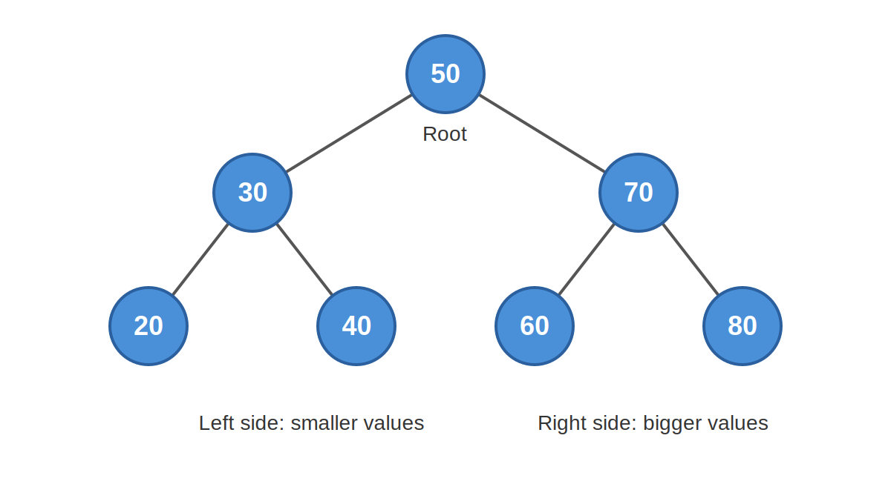
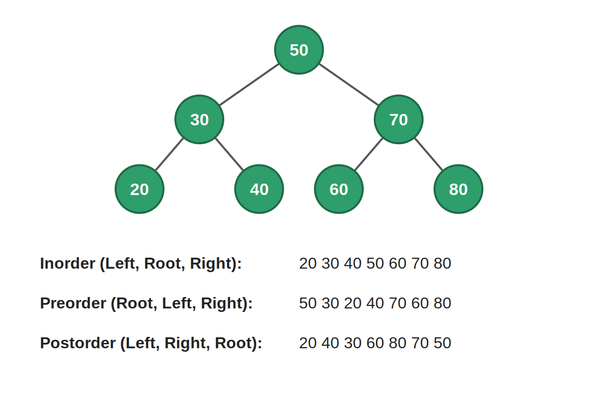
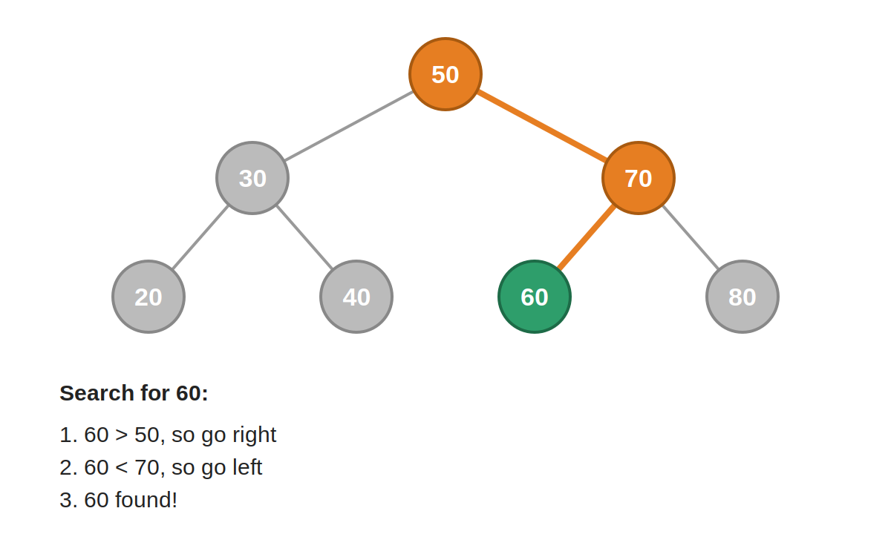

# Binary Search Tree (BST) Questions in C++

This folder contains practice questions and solutions on Binary Search Tree (BST) using C++.

## What is a Binary Search Tree?

A BST is a tree where, for every node:
- The left subtree has values **smaller** than the node
- The right subtree has values **greater** than the node



## Purpose

The purpose of this folder is to:
- Practice and understand BST concepts
- Solve different BST problems in one place
- Improve problem-solving skills in C++
- Prepare for exams and coding interviews

## Traversals



- **Inorder:** Left, Root, Right
- **Preorder:** Root, Left, Right
- **Postorder:** Left, Right, Root

## Searching in a BST



To search for a value, start at the root:
- If the value is smaller, go left
- If the value is greater, go right
- If it matches, the value is found

## What is Inside

Multiple BST questions, each solved in a separate `.cpp` file.

## Folder Structure

```
BST-Questions/
├── images/
│   ├── bst_example.png
│   ├── bst_traversal.png
│   └── bst_search.png
├── question1.cpp
├── question2.cpp
└── README.md
```

## How to Run

```bash
g++ filename.cpp -o program
./program
```

On Windows:

```bash
g++ filename.cpp -o program.exe
program.exe
```

## Author

Siraj U Din
