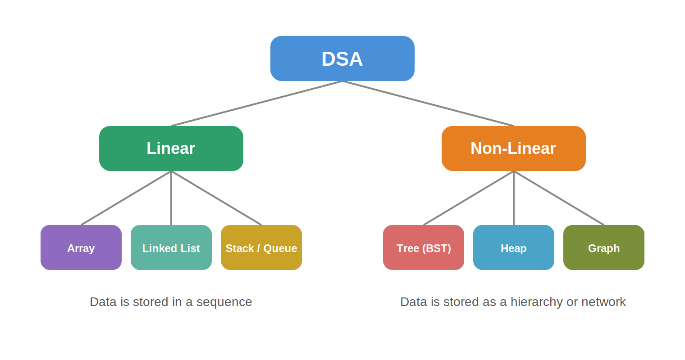
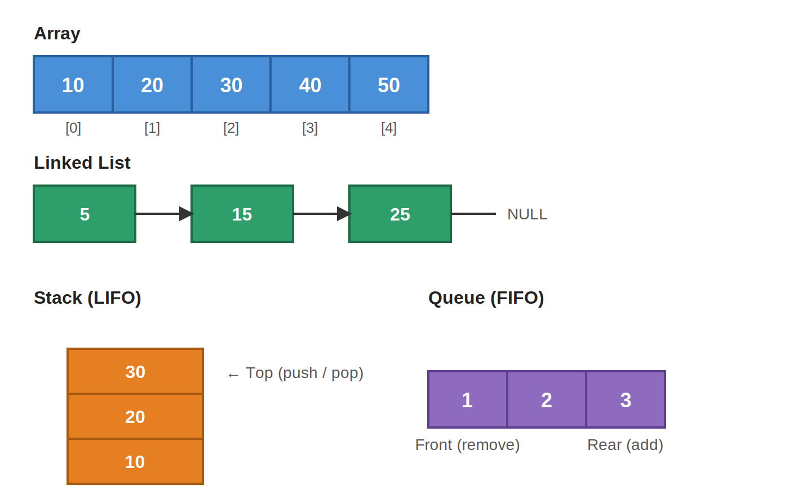
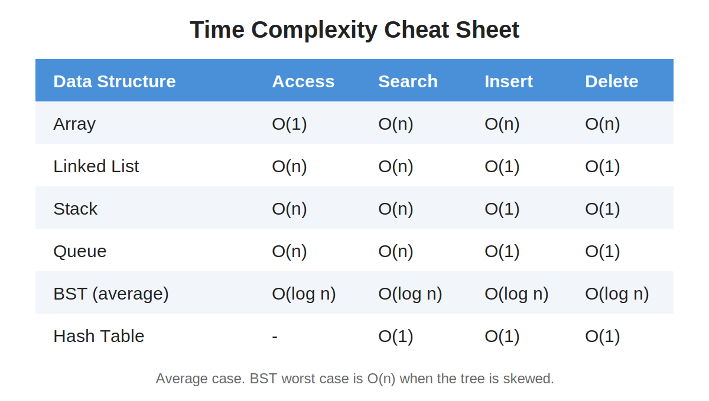

# Data Structures and Algorithms (DSA) in C++

This repository contains my practice work on Data Structures and Algorithms using C++. Each topic has its own folder with questions and solutions.

## What is DSA?

- **Data Structure:** a way of storing and organizing data so it can be used efficiently.
- **Algorithm:** a step-by-step method to solve a problem.



## Purpose

The purpose of this repository is to:
- Learn and practice DSA concepts in C++
- Keep all topics organized in one place
- Improve problem-solving skills
- Prepare for exams and coding interviews

## Linear Data Structures



- **Array:** elements stored in continuous memory
- **Linked List:** nodes connected using pointers
- **Stack:** Last In, First Out (LIFO)
- **Queue:** First In, First Out (FIFO)

## Time Complexity



## Topics Covered

| No. | Topic | Folder |
|-----|-------|--------|
| 1 | Arrays | Arrays/ |
| 2 | Linked List | LinkedList/ |
| 3 | Stack | Stack/ |
| 4 | Queue | Queue/ |
| 5 | Binary Search Tree | BST-Questions/ |
| 6 | Sorting Algorithms | Sorting/ |
| 7 | Searching Algorithms | Searching/ |

Folder names ko apne asli folders ke hisab se badal lena.

## Folder Structure

```
DSA/
├── images/
│   ├── dsa_overview.png
│   ├── dsa_linear.png
│   └── dsa_complexity.png
├── Arrays/
├── LinkedList/
├── Stack/
├── Queue/
├── BST-Questions/
└── README.md
```

## How to Run

```bash
g++ filename.cpp -o program
./program
```

On Windows:

```bash
g++ filename.cpp -o program.exe
program.exe
```

## Author

Siraj U Din
